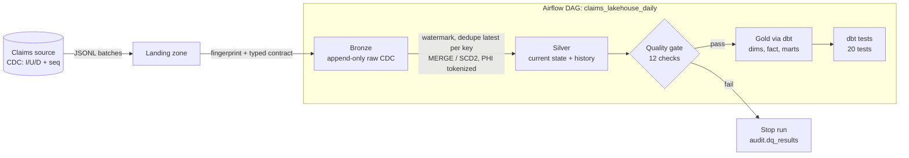

# Healthcare Claims Lakehouse

[](https://github.com/vivekdatla96/healthcare-claims-lakehouse/actions/workflows/ci.yml)


A medallion (bronze / silver / gold) pipeline for healthcare claims that handles the parts real
claims platforms struggle with: **CDC from a transactional source, out-of-order and replayed
events, SCD Type 2 member history, PHI de-identification, and a data quality gate** in front of the
analytics layer.

Everything runs locally on DuckDB in under a minute, and the same patterns map directly onto
Snowflake, Databricks (Delta Lake) or Synapse. All data is synthetic.

## Architecture



| Layer | Tables | What happens |
|-------|--------|--------------|
| **Bronze** | `members`, `providers`, `claims` | Raw CDC appended as received. Explicit schemas (no inference). Each file is SHA-256 fingerprinted in `audit.ingest_log`, so reruns never duplicate rows. |
| **Silver** | `claims`, `providers`, `member_history` | Incremental from a per-entity high-water mark. Latest change per key wins, `_seq` guards against out-of-order events, deletes are applied. Members are kept as **SCD Type 2**, applied one source batch at a time so no version is lost. |
| **Quality** | `audit.dq_results` | Referential integrity, payment logic (paid <= allowed <= billed), SCD2 overlap detection, NPI format, and a check that **no raw PHI column exists in silver**. Error checks stop the DAG. |
| **Gold** | `dim_member`, `dim_member_scd`, `dim_provider`, `fct_claims`, 2 marts | dbt models. `fct_claims` joins member attributes **as of the service date** (point-in-time), not as of today. |

## PHI handling

Direct identifiers never leave bronze:

| Source column | Silver / gold | Method |
|---|---|---|
| `member_id` | `member_token` | Salted SHA-256, deterministic so joins still work |
| `date_of_birth` | `birth_year`, `age_band` | Generalized |
| `zip_code` | `zip3` | Truncated (Safe Harbor style) |
| name, email, phone | dropped | |

The salt comes from `CLAIMS_PHI_SALT` (in production: Key Vault / Secrets Manager). Two separate
tests, one in Python and one in dbt, fail the build if an identifier column ever appears
downstream.

## Quick start

```bash
pip install -r requirements.txt
make all        # generate 3 CDC batches -> bronze -> silver -> quality -> dbt build
make test       # pytest
```

Or step by step:

```bash
export PYTHONPATH=src
python -m claims_pipeline generate --batches 5 --claims 5000
python -m claims_pipeline run
cd dbt && dbt build --profiles-dir .
```

Run it twice: the second run loads 0 files and applies 0 changes.

Sample output from `gold.mart_monthly_paid_by_specialty`:

```
specialty      claims   billed     paid
Orthopedics       272   90073.88   32269.79
Pediatrics        153   51312.81   16549.52
Endocrinology     163   56066.52   16332.27
```

## Project layout

```
src/claims_pipeline/
  generate.py   synthetic source system emitting CDC batches
  schemas.py    typed source contracts and primary keys
  ingest.py     idempotent bronze loader
  phi.py        tokenization and generalization
  silver.py     watermark-driven MERGE and SCD2
  quality.py    data quality gate with audit table
  cli.py        generate | ingest | silver | quality | run
dbt/            gold models, marts, generic and singular tests
airflow/dags/   daily DAG (Airflow 2.x and 3.x)
tests/          pytest: CDC correctness against source truth, idempotency, SCD2, DQ gate
```

## Design notes

- **Why recompute "latest per key" inside the window instead of row by row?** One set-based
  `QUALIFY row_number()` plus a single `MERGE` per entity is how this scales on Snowflake or Delta.
- **Why per-batch SCD2?** If three daily batches land before a run, collapsing them would drop two
  member versions and break point-in-time joins for claims in those days.
- **Why a Python quality gate and dbt tests?** The gate protects gold from bad silver data before
  anything is rebuilt; dbt tests verify the gold models themselves.

## Mapping to production stacks

| Here | Snowflake | Databricks |
|------|-----------|------------|
| JSONL landing | Stage + Snowpipe | Auto Loader |
| `audit.ingest_log` | `COPY` load history | Auto Loader checkpoint |
| `MERGE` on silver | `MERGE` / Streams + Tasks | Delta `MERGE INTO` |
| SCD2 | dbt snapshots / Dynamic Tables | Delta Live Tables `APPLY CHANGES` |
| Airflow | Airflow / ADF | Workflows / Airflow |

## Roadmap

- [ ] Kafka (Debezium) source in place of JSONL batches
- [ ] Iceberg table format for bronze
- [ ] Incremental dbt models for `fct_claims`
- [ ] Great Expectations style data docs for `audit.dq_results`

---
Built by [Vivek Datla](https://github.com/vivekdatla96).
